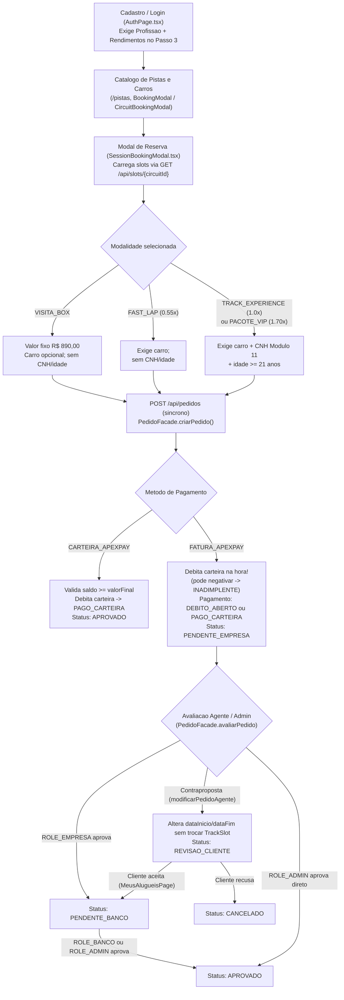

# Mapeamento Completo do Fluxo do Sistema — Apex Track & Pitlane (RentCars)

Este documento mapeia a transição do projeto **RentCars** (sistema clássico de locação de veículos com múltiplos agentes) para a plataforma atual **Apex Track & Pitlane** (experiências em autódromo por turno com carteira digital `ApexPay`), detalha o fluxo real implementado hoje no código e aponta os **8 principais gaps ("efeito Frankenstein")** onde regras antigas e novas colidem ou ficaram desconectadas.

---

## 1. Antes vs. Agora: O que mudou no modelo de negócio

| Dimensão | Sistema Legado (RentCars Clássico) | Plataforma Atual (Apex Track & Pitlane) |
| :--- | :--- | :--- |
| **Produto principal** | Aluguel diário de veículos comuns por período livre (`dataInicio` a `dataFim`). | Sessões em autódromo por turno (`TrackSlot`) com 4 modalidades: `VISITA_BOX`, `FAST_LAP`, `TRACK_EXPERIENCE` e `PACOTE_VIP`. |
| **Atores / Perfis** | `CLIENTE`, `EMPRESA` (aprovação operacional / frota) e `BANCO` (análise de crédito / aprovação financeira). | `CLIENTE` e `ADMIN` (`admin@apex.com` / `ROLE_ADMIN`), embora contas e rotas legadas (`empresa@rentcars.com`, `banco@rentcars.com`) ainda existam. |
| **Aprovação da reserva** | Fluxo em duas etapas: `PENDENTE_EMPRESA` -> `PENDENTE_BANCO` -> `APROVADO` (ou `REVISAO_CLIENTE` via contraproposta). | Aprovação instantânea via saldo em carteira (`CARTEIRA_APEXPAY` -> `APROVADO`), convivendo com aprovação manual em 2 etapas no pagamento por fatura (`FATURA_APEXPAY`). |
| **Critério financeiro** | Análise de crédito baseada em `Profissão` e `Rendimentos` do cliente (`AnalisesPage.tsx`). | Carteira pré-paga `ApexPay` com sistema de tiers por volume (`Bronze` 0%, `Silver` 5% a partir de R$ 10 mil, `Gold` 10% a partir de R$ 25 mil, `Apex Black` 15% a partir de R$ 50 mil). |
| **Disponibilidade** | Datas livres no calendário do veículo. | Grade semanal em `ComoFuncionaSection.tsx` (Seg fechado para manutenção FIA; Ter–Qui reduzido; Sex–Dom Full Grid + Noturno) e janela de 14 dias de `TrackSlot`s semeados no `DataInitializer.java` para 8 circuitos e 8 supercarros (cada carro ligado a 3 circuitos). |

---

## 2. Fluxo Atual no Código (Ponta a Ponta)

### 2.1 Visão Geral do Fluxo

### 2.2 Detalhamento por Etapa

1. **Cadastro e Autenticação (`AuthPage.tsx` e `DataInitializer.java`)**
   - No Passo 3 do cadastro público (`AuthPage.tsx`), o cliente ainda é obrigado a preencher `Profissão` e `Rendimentos`.
   - O `DataInitializer.java` cria 8 circuitos, 14 dias de `TrackSlot`s, 8 supercarros (cada um vinculado a 3 circuitos via `circuitosDisponiveis`) e três contas operacionais/administrativas:
     - `admin@apex.com` (`ROLE_ADMIN`)
     - `empresa@rentcars.com` (`ROLE_EMPRESA`)
     - `banco@rentcars.com` (`ROLE_BANCO`)

2. **Escolha da Experiência (`ComoFuncionaSection.tsx`, `BookingModal.tsx`, `CircuitBookingModal.tsx`, `SessionBookingModal.tsx`)**
   - A página inicial apresenta as regras operacionais (`Arrive & Drive`, `Posse em Pista`, `All-Inclusive Box`, `Proteção ApexPay`) e a grade semanal (`WEEKLY_SCHEDULE`).
   - Os modais `BookingModal.tsx` e `CircuitBookingModal.tsx` atuam como wrappers para `SessionBookingModal.tsx`, que consulta turnos disponíveis em `GET /api/slots/${selectedCircuitId}` e oferece o atalho de CNH válida em Módulo 11 (`52798802310`).

3. **Criação e Regras do Pedido (`PedidoFacade.criarPedido` — `PedidoFacade.java`)**
   - `VISITA_BOX`: preço fixo de `890.00` BRL, `automovel` opcional, sem exigência de CNH ou idade.
   - `FAST_LAP`: multiplicador `0.55`, exige veículo, sem exigência de CNH ou idade.
   - `TRACK_EXPERIENCE`: multiplicador `1.0` (padrão), exige veículo + CNH válida pelo Módulo 11 (`CnhValidator.isValid`) + idade `>= 21`.
   - `PACOTE_VIP`: multiplicador `1.70`, exige veículo + CNH válida pelo Módulo 11 (`CnhValidator.isValid`) + idade `>= 21`.
   - Desconto de tier (`ApexPaySection.tsx` / carteira): `Bronze` (0%), `Silver` (5% a partir de R$ 10 mil), `Gold` (10% a partir de R$ 25 mil) e `Apex Black` (15% a partir de R$ 50 mil).
   - Pagamento:
     - `CARTEIRA_APEXPAY`: bloqueia se `saldoAtual.compareTo(valorFinal) < 0`; debita via `apexPayFacade.debitarValorLiquido`, marca `pagamentoStatus = "PAGO_CARTEIRA"` e aprova imediatamente (`status = "APROVADO"`).
     - `FATURA_APEXPAY`: chama `apexPayFacade.debitarValorLiquido` já na criação do pedido (podendo deixar o saldo negativo e marcar `cliente.isInadimplente() == true`), define `pagamentoStatus` como `"DEBITO_ABERTO"` ou `"PAGO_CARTEIRA"` e cria o pedido com `status = "PENDENTE_EMPRESA"`.

4. **Acompanhamento, Aprovação e Pós-Reserva (`PedidoFacade.java`, `MeusAlugueisPage.tsx`, `AdminDashboardFacade.java`)**
   - Em `PedidoFacade.avaliarPedido`, se quem aprova tem `ROLE_EMPRESA`, um pedido `PENDENTE_EMPRESA` avança apenas para `PENDENTE_BANCO`, exigindo nova aprovação de `ROLE_BANCO` ou `ROLE_ADMIN` para chegar a `APROVADO`. Apenas `ROLE_ADMIN` aprova direto de `PENDENTE_EMPRESA` ou `PENDENTE_BANCO` para `APROVADO`.
   - Em `MeusAlugueisPage.tsx`, o cliente vê seus pedidos, pode cancelar (`cancelarPedidoCliente`, com `liberarSlotSePresente` e `estornarSeNecessario`), visualizar alertas de `valorSinistro` e responder contrapropostas (`responder-revisao`).
   - No painel administrativo, `AdminDashboardFacade.registrarSinistro` permite lançar uma cobrança de sinistro no cliente associado ao pedido.

---

## 3. Os 8 Gaps Encontrados ("Efeito Frankenstein")

Ao migrar do modelo antigo para o modelo de autódromo + ApexPay, partes do fluxo antigo permaneceram ativas enquanto novas funcionalidades foram acopladas sem integração completa:

### Gap 1 — Coexistência dos perfis legados (`ROLE_EMPRESA` e `ROLE_BANCO`) com `ROLE_ADMIN`
- **Onde aparece:** `DataInitializer.java`, `PedidoFacade.avaliarPedido`, e rotas `/pedidos`, `/frota`, `/analises`.
- **O problema:** O sistema atual deveria ser centralizado na operação Apex (`ROLE_ADMIN`), mas os estados de 2 etapas (`PENDENTE_EMPRESA` -> `PENDENTE_BANCO`) e os usuários/telas de `EMPRESA` e `BANCO` continuam ativos, criando burocracia que não faz mais sentido no fluxo de pista.

### Gap 2 — `FATURA_APEXPAY` debita a carteira na criação e torna o cliente inadimplente antes da aprovação
- **Onde aparece:** `PedidoFacade.java` (linhas 228–236).
- **O problema:** Ao escolher `FATURA_APEXPAY`, o backend executa `apexPayFacade.debitarValorLiquido` imediatamente no momento da solicitação. Se o cliente não tiver saldo suficiente, sua conta fica negativa (`cliente.isInadimplente() == true`) e `pagamentoStatus` vira `"DEBITO_ABERTO"` **mesmo com o pedido ainda em `PENDENTE_EMPRESA`** (antes de qualquer aprovação).

### Gap 3 — Cadastro exige `Profissão` e `Rendimentos`, mas o agendamento ignora esses dados
- **Onde aparece:** `AuthPage.tsx` (Passo 3), `SessionBookingModal.tsx` e `AnalisesPage.tsx`.
- **O problema:** O cadastro força o usuário a informar profissão e renda mensal como no sistema antigo de locação com análise bancária. Porém, na reserva (`SessionBookingModal` / `PedidoFacade`), essa informação não é usada em nenhuma regra — apenas o saldo/tier da carteira ApexPay importa. O motor de renda/score ficou isolado na tela legada `/analises` (`AnalisesPage.tsx`).

### Gap 4 — Contraproposta altera datas livres sem atualizar `TrackSlot` e retorna para `PENDENTE_BANCO`
- **Onde aparece:** `PedidoFacade.modificarPedidoAgente` (linhas 312–390), `PedidoFacade.responderContrapropostaCliente` (linhas 392–412) e `MeusAlugueisPage.tsx`.
- **O problema:** A contraproposta ainda opera no modelo antigo de datas livres (`dataInicio` e `dataFim`), sem liberar o `TrackSlot` original nem alocar capacidade em um novo slot de box. Além disso, quando o cliente aceita a revisão (`aceito=true`), o status vai para `PENDENTE_BANCO` em vez de `APROVADO` (ou `PENDENTE_APROVACAO`).

### Gap 5 — Cadastro de novos veículos em `/frota` não vincula circuitos nem flag de box
- **Onde aparece:** `FrotaPage.tsx` e `carSchema.ts`.
- **O problema:** O formulário de criação/edição de automóveis aceita `matricula`, `marca`, `modelo`, `ano`, `placa`, `precoPorDia`, `categoria`, `potenciaCv`, `aceleracao0a100`, `velocidadeMaxima` e `imageUrl`, mas **não possui seletor para `circuitosDisponiveis` nem `ativoBox`**. Como os circuitos filtram carros por esse vínculo, novos carros criados pelo painel nunca aparecem disponíveis em `/pistas`.

### Gap 6 — Fila assíncrona (`ReservaQueueEngine`) existe no backend e no painel Admin, mas nunca é acionada
- **Onde aparece:** `PedidoController.java` (linhas 36–51), `SessionBookingModal.tsx` (linha 361) e `AdminDashboardPage.tsx`.
- **O problema:** O `PedidoController` expõe `@Post("/async")` usando `queueEngine.enfileirar(msg)` (Virtual Threads + DLQ exibida no `/admin`), mas o `SessionBookingModal.tsx` chama apenas o endpoint síncrono `api.post('/api/pedidos', payload)`. Na prática, a fila monitorada no painel administrativo permanece ociosa no fluxo normal do usuário.

### Gap 7 — Registro de sinistro permite cobrar dano em pedidos não aprovados e em `VISITA_BOX`
- **Onde aparece:** `AdminDashboardFacade.registrarSinistro` (linhas 230–252) e `AdminDashboardPage.tsx`.
- **O problema:** O método verifica apenas `p.getCliente() != null`, sem validar se `p.getStatus()` é `"APROVADO"` nem impedir que seja aplicado sobre a modalidade `"VISITA_BOX"`. Isso permite lançar cobrança de sinistro/dano em pedidos `REJEITADO`, `CANCELADO`, `PENDENTE` ou de simples visitação ao box.

### Gap 8 — Painel administrativo fragmentado em 4 rotas desconexas
- **Onde aparece:** Rotas `/admin`, `/pedidos`, `/frota` e `/analises`.
- **O problema:** A gestão do sistema está espalhada entre o novo dashboard (`/admin`) e três telas herdadas do modelo antigo (`/pedidos`, `/frota`, `/analises`), dificultando a navegação e reforçando a mistura de conceitos entre locadora tradicional e autódromo.

---

## 4. Próximos Passos Sugeridos (Plano de Unificação)

1. **Unificar os papéis e simplificar os status de pedido:**
   - Eliminar a dependência operacional de `ROLE_EMPRESA` e `ROLE_BANCO`, mantendo apenas `CLIENTE` e `ADMIN` (ou transformando `/pedidos`, `/frota` e `/analises` em abas unificadas dentro da experiência de `/admin`).
   - Substituir `PENDENTE_EMPRESA` e `PENDENTE_BANCO` por um único estado `PENDENTE_APROVACAO` (ou `AGUARDANDO_FATURA`) quando não houver aprovação automática pela carteira.
2. **Corrigir o fluxo de pagamento por `FATURA_APEXPAY`:**
   - Na criação de pedido via fatura, não debitar a carteira imediatamente: registrar a pendência e só efetivar a cobrança/débito após a aprovação ou liquidação, evitando negativar o cliente antes do aceite.
3. **Alinhar cadastro (`AuthPage.tsx`) e análise de crédito (`/analises`):**
   - Definir explicitamente se `Profissão` e `Rendimentos` passarão a determinar o limite de crédito permitido em `FATURA_APEXPAY` ou se devem ser removidos do cadastro obrigatório por não fazerem parte do modelo `ApexPay`.
4. **Atualizar a contraproposta para operar sobre `TrackSlot`:**
   - Fazer `modificarPedidoAgente` exigir um novo `slotId` válido, trocando a reserva de vaga com segurança e levando a aceitação do cliente diretamente para `APROVADO` (se já garantido) ou `PENDENTE_APROVACAO`.
5. **Completar o cadastro de frota em `FrotaPage.tsx`:**
   - Adicionar ao `carSchema.ts` e ao formulário de veículos os campos `circuitosDisponiveis` (multi-seleção dos circuitos) e `ativoBox` para que novos carros fiquem imediatamente reserváveis em `/pistas`.
6. **Integrar ou limpar o processamento assíncrono (`ReservaQueueEngine`):**
   - Decidir se o `SessionBookingModal.tsx` deve enviar reservas via `/api/pedidos/async` (ativando de fato as métricas e DLQ no `/admin`) ou se o endpoint síncrono deve registrar telemetria na engine de fila.
7. **Blindar `AdminDashboardFacade.registrarSinistro`:**
   - Exigir que o pedido esteja com `status == "APROVADO"` e `tipoServico != "VISITA_BOX"` antes de lançar qualquer valor de sinistro.
